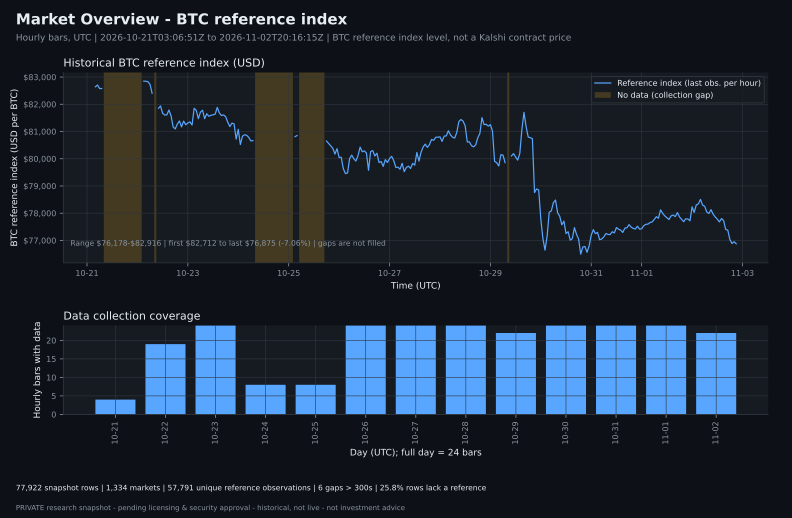
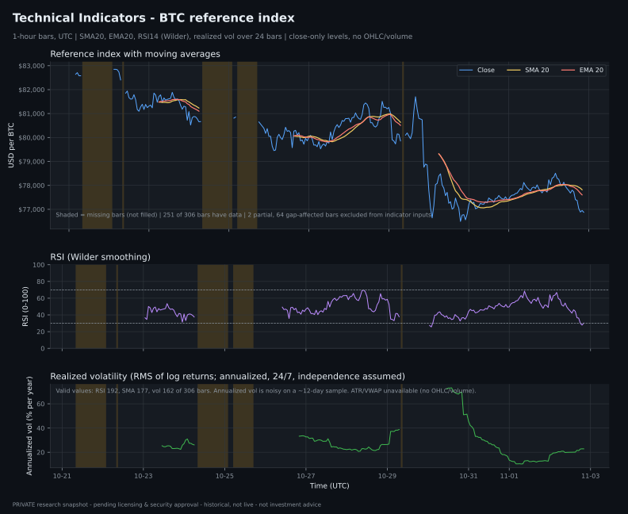
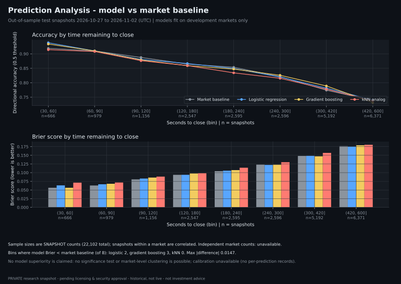
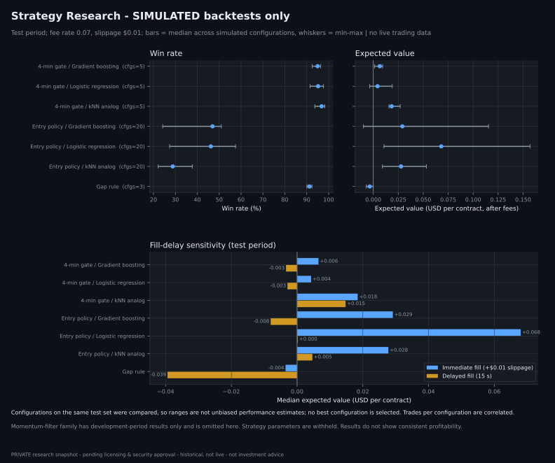

# Bitcoin Quantitative Research — KXBTC15M

An offline research portfolio for Kalshi's 15-minute Bitcoin markets. The project compares market-implied
probabilities, rule-based strategies, statistical classifiers, and a four-minute k-nearest-neighbours analog model.

> **RESEARCH PORTFOLIO.** Historical research only. The public edition excludes raw market data, account-level
> records, and credentials. It does not demonstrate a durable trading advantage and is not investment advice.

## Research question

Does a high observed win rate remain profitable after the contract price, fees, slippage, execution delay, and
market-regime changes are included?

The strongest result is intentionally conservative: **accuracy alone was not an edge, and several attractive
backtests disappeared after realistic execution assumptions were introduced.**

## Dataset snapshot

The current private research snapshot ends on 2026-11-02 UTC.

| Item | Value |
|---|---:|
| Market snapshots | 77,922 |
| Distinct markets | 1,334 |
| Settled markets | 1,333 |
| Snapshot cadence | Approximately 15 seconds |
| BRTI reference coverage | Approximately 12 days |
| Live-order audit rows | 572, private and not approved for publication |

Raw data and account-level order records are not part of the intended public portfolio. See
[Data policy](data/README.md) and the [publication checklist](docs/PUBLICATION_CHECKLIST.md).

## Results at a glance

| Study | Result | Interpretation |
|---|---|---|
| Baseline replay | 94–95% win rates were often below fee-adjusted break-even | High accuracy can still lose money |
| Momentum v1 | Losses were asymmetric and concentrated in reversals | A few full-cost losses erased many small wins |
| Distance and volatility | Time-adjusted distance was more useful than raw BTC distance | Dollar distance must be interpreted by volatility and time |
| Pattern classifiers | Logit, gradient boosting, and kNN were close to market probabilities | No model established clear superiority |
| Execution sensitivity | Several apparent edges became negative with a 15-second delay | Fillability and adverse selection matter |
| Analog 4-minute model | Production-compatible artifact built from settled BRTI histories | Data pipeline validated; profitability not established |

Read the concise [model comparison](reports/PORTFOLIO_SUMMARY.md) or the
[full strategy analysis](reports/KALSHI_STRATEGY_ANALYSIS.md).

## Research dashboards

The charts are generated from validated aggregate JSON, not directly from private order records.

### Market overview



### Technical indicators



### Prediction analysis



### Strategy research



Definitions and limitations are documented in [dashboard data mapping](docs/DASHBOARD_DATA_MAPPING.md) and
[validation findings](docs/VALIDATION_FINDINGS.md).

## Portfolio reports

1. [Model comparison summary](reports/PORTFOLIO_SUMMARY.md)
2. [Strategy comparison and model tests](reports/KALSHI_STRATEGY_ANALYSIS.md)
3. [Momentum v1 loss analysis](reports/MOMENTUM_V2_ANALYSIS.md)
4. [Pattern model and timing analysis](reports/PATTERN_MODEL_AND_TIMING_ANALYSIS.md)
5. [Analog four-minute entry study](reports/ANALOG_4MIN_ENTRY.md)
6. [Forward paper experiment plan](reports/KALSHI_EXPERIMENT_PLAN.md)
7. [Analog data validation](outputs/analog_4min_v1/DATA_VALIDATION.md)

Reports are frozen research snapshots. Their dates and assumptions are part of the result and should not be read as
current market performance.

## Methods demonstrated

- chronological development/test splits with markets kept intact;
- official settlement labels rather than outcomes inferred from the final snapshot;
- calibration, Brier score, and fee-adjusted break-even analysis;
- fee, slippage, delayed-fill, and limited-quantity scenarios;
- bootstrap uncertainty intervals, drawdown, and failure analysis;
- logistic regression, gradient boosting, kNN analogs, and rule-based baselines;
- reproducible aggregate dashboards and model artifacts;
- explicit documentation of negative, unstable, and inconclusive results.

## Repository structure

```text
assets/charts/       generated SVG portfolio charts
public/dashboards/   validated aggregate dashboard JSON
reports/             findings, limitations, and experiment design
docs/                data definitions, validation, and release guidance
shared/              public-safe dashboard loaders, metrics, and schemas
src/                 feature, replay, strategy, and model logic
experiments/         focused hypothesis checks
scripts/             dashboard builders and synthetic test-data generator
tests/               unit tests for the public-facing analytics layer
data/                local input boundary; raw files are private
outputs/             generated research artifacts
run.py               analysis command-line entry point
```

## Setup

Python 3.11+ is recommended.

```bash
python -m venv .venv
source .venv/bin/activate
pip install -r requirements.txt
```

## Public-safe example data

Generate two deterministic synthetic markets without network access, credentials, Downloads access, or writes to
`data/raw/`:

```bash
python scripts/update_data.py
```

The generated records are labeled `synthetic_test_fixture` and are intended only for schema and pipeline tests.

## Reproduce the dashboard layer

With authorized local inputs available:

```bash
python -m unittest discover -s tests
python scripts/generate_dashboards.py
python scripts/generate_charts.py
```

The chart generator reads only `public/dashboards/*.json`.

## Research CLI

| Command | Purpose |
|---|---|
| `python run.py actual` | Audit actual fills and reconstruct entry-time features |
| `python run.py simulated` | Compare momentum v1 and the selected v2 hypothesis |
| `python run.py filters` | Measure individual v2 filter impact |
| `python run.py model` | Evaluate pattern logit, gradient boosting, and kNN models |
| `python run.py gap` | Fit and replay time-specific distance thresholds |
| `python run.py legacy <name>` | Run a focused historical experiment |

`python run.py check` validates headline values from an older frozen report and currently fails on the enlarged dataset.
The reason is documented in [validation findings](docs/VALIDATION_FINDINGS.md); expectations should not be silently
changed merely to make the check pass.

## Data and publication status

This public portfolio contains an allowlisted research surface only:

- raw snapshots, live orders, derived per-order files, and backups are excluded;
- private fetch integrations are excluded and the included example generator is synthetic;
- compact model and dashboard artifacts contain no account-level records;
- publication does not grant redistribution rights to the underlying Kalshi or CF Benchmarks data.

The private source repository and its Git history are not copied into this clean public repository.

## Limitations

- Short observation window and a limited set of BTC regimes.
- Fifteen-second snapshots miss intra-interval order-book movement and queue position.
- Displayed top-of-book prices do not prove fillability.
- Multiple explored hypotheses create selection-bias risk.
- Strategy results are sensitive to fees, latency, slippage, and settlement mechanics.
- Snapshot-level prediction rows within one market are correlated and not independent samples.

Candidate strategies should remain in shadow or paper testing until they pass a pre-registered, forward-looking
evaluation with decision-time quotes, depth, fills, latency, fees, and official settlements.
